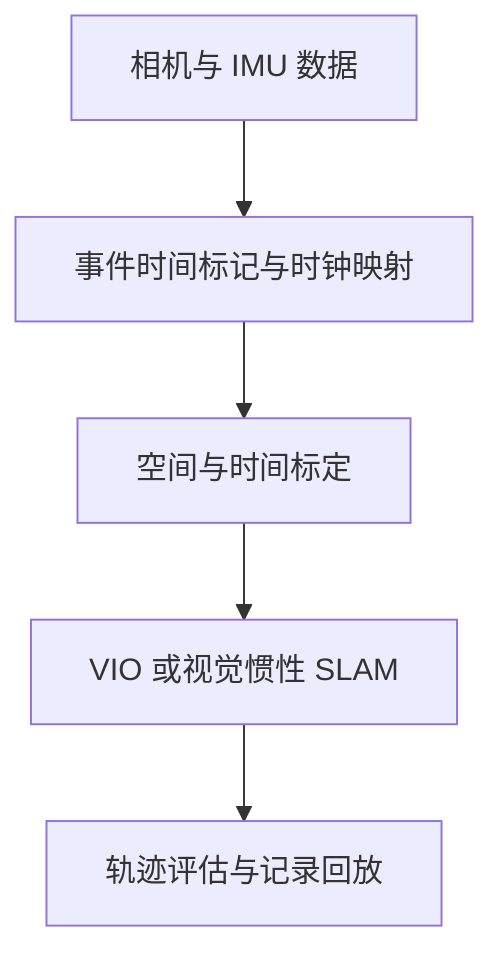

# VIO Open Source Collection

视觉惯性里程计与相关项目合集，覆盖 SLAM、软件时间处理、硬件同步、标定与评估。

[English](README.md) · [简体中文](README-zh.md)

[项目目录](docs/CATALOG-zh.md) · [集成指南](docs/INTEGRATION-zh.md)

**47 项资源 · 8 个类别 · 资料日期：2026-10-23**

## 1. 合集定位

本合集将**状态估计算法**与落地所需的**传感器时序和标定**放在同一条链路中整理，适用于移动机器人、手持采集、机械臂相机，以及在 PC 端运行 VIO 的从夹爪。

- **算法：** VIO、视觉惯性 SLAM，并单独标识纯视觉 SLAM 和稠密建图扩展。
- **采集与同步：** 时钟转换、时间偏移估计、相机触发、曝光反馈、MCU 参考设计及传感器驱动。
- **集成与评估：** 时空标定、IMU 噪声分析、数据记录回放和轨迹误差评估。

每项资源提供上游源码入口、能力说明、依赖和许可边界。本仓库是文档合集，具体安装与使用以各上游项目为准。

## 2. 项目分类导航

点击类别可直接进入详细条目与集成说明。数量包含公开参考工程及许可受限资源，具体限制在目录中单独标明。

| 类别与数量 | 代表项目 |
| --- | --- |
| [VIO / 视觉惯性 SLAM](docs/CATALOG-zh.md#vio) · **10** | OpenVINS、Basalt、ORB-SLAM3、OKVIS2 |
| [软件时间处理](docs/CATALOG-zh.md#software-sync) · **6** | Cuckoo Time Translator、MAVROS、LinuxPTP |
| [硬件同步](docs/CATALOG-zh.md#hardware-sync) · **10** | VersaVIS、LIV_handhold、OctoSense |
| [驱动与采集 SDK](docs/CATALOG-zh.md#drivers) · **6** | librealsense、DepthAI、Aravis、libcamera |
| [空间与时间标定](docs/CATALOG-zh.md#calibration) · **5** | Kalibr、iKalibr、Allan Variance ROS |
| [评估与记录](docs/CATALOG-zh.md#evaluation) · **3** | evo、rosbag2、MCAP |
| [建图扩展](docs/CATALOG-zh.md#mapping) · **6** | OKVIS2-X、FAST-LIVO2、VIGS-SLAM |
| [许可受限源码](docs/CATALOG-zh.md#restricted-source) · **1** | cuVSLAM |

## 3. 按需求选择入口

以下用于建立对照和开始研究，不代表性能排名。

| 需求 | 起步项目与核对要点 |
| --- | --- |
| 建立 VIO 基线 | [OpenVINS](https://github.com/rpng/open_vins)、[Basalt](https://gitlab.com/VladyslavUsenko/basalt) 核对：相机模型、IMU 频率、标定格式与目标运行环境 |
| 增加回环和地图复用 | [ORB-SLAM3](https://github.com/UZ-SLAMLab/ORB_SLAM3)、[OKVIS2](https://github.com/ethz-mrl/okvis2) 核对：初始化、重定位与坐标重置行为 |
| 研究软件时间处理 | [Cuckoo Time Translator](https://github.com/ethz-asl/cuckoo_time_translator)、[MAVROS](https://github.com/mavlink/mavros)、[VINS-Mono](https://github.com/HKUST-Aerial-Robotics/VINS-Mono) 核对：时钟映射与有效测量时刻估计是不同问题 |
| 设计硬件同步 | [VersaVIS](https://github.com/ethz-asl/versavis)、[LIV_handhold](https://github.com/xuankuzcr/LIV_handhold) 核对：触发支持、曝光反馈、电平与图像关联 |
| 完成标定和对照评估 | [Kalibr](https://github.com/ethz-asl/kalibr)、[evo](https://github.com/MichaelGrupp/evo)、[rosbag2](https://github.com/ros2/rosbag2) 核对：内外参、时间偏移、参考精度及轨迹对齐方式 |
| 扩展更丰富的地图 | [OKVIS2-X](https://github.com/ethz-mrl/OKVIS2-X)、[FAST-LIVO2](https://github.com/hku-mars/FAST-LIVO2)、[VIGS-SLAM](https://github.com/cvg/VIGS-SLAM) 核对：额外传感器、GPU 需求、地图延迟与组件许可 |

采集 SDK、噪声工具、其他算法及源码可获取方案，见[完整项目目录](docs/CATALOG-zh.md)。

## 4. 软硬件如何配合

软件时间处理与硬件同步分别解决同一采集链路中的不同问题。

| 层次 | 职责与对应资源 |
| --- | --- |
| 硬件事件 | 触发曝光，或在设备端记录曝光与 IMU 事件时间 VersaVIS、STM32 和 Teensy 参考工程 |
| 时钟映射 | 关联相机、MCU 与 PC 时钟，处理偏移及速率差 Cuckoo Time Translator、MAVLink TIMESYNC、LinuxPTP |
| 时间标定 | 估计图像与 IMU 有效测量时刻之间的剩余偏移 Kalibr、OpenVINS、VINS |
| 关联与记录 | 匹配帧与事件、选取 IMU 区间，并保留可回放数据 驱动缓存、message_filters、rosbag2、MCAP |

保留传感器源时间戳，另记 PC 收包时间。固定时间偏移可估计，随机抖动、时钟漂移及丢样本需要分别处理；仅靠消息近似配对无法修正采样时间。

硬件触发有助于控制时序，也可以先用可靠源时间戳和软件时间处理开展 VIO 原型验证。时间戳分辨率、同步精度和位姿精度是不同指标。

## 5. 快速开始

1. **明确输入：** 相机及快门模型、帧率、IMU 采样率、时间戳语义和可用算力。
2. **选择基线：** 从上方[需求表](#3-按需求选择入口)选择候选，阅读目录条目及上游安装说明。
3. **先记录原始数据：** 同时保存图像、IMU、源时间与接收时间、序号和标定文件。
4. **标定后比较：** 在同一记录上对照算法，统一参考系、时间对齐、APE/RPE 和参考数据的误差约定。
5. **按实测问题增强：** 再决定是否引入硬件同步、回环、LiDAR 或稠密建图。

鱼眼加 IMU 的从夹爪方案，可阅读 [PC 端集成指南](docs/INTEGRATION-zh.md)，核对 MCU 计时、相机与 IMU 接口、帧号、标定、质量状态及抓取工况评估。视触觉可以先接入同一记录时间轴；融合仍需额外的接触或状态估计模型。

## 6. 文档

- [项目目录](docs/CATALOG-zh.md)：全部 47 项资源、用途及集成和许可边界。
- [从夹爪集成指南](docs/INTEGRATION-zh.md)：软硬同步、信号接口、SDK 元数据与评估方法。
- [English documentation](README.md)：对应的英文首页与指南。

## 7. 维护与许可

新增或更新条目时，补齐官方源码、传感器输入、用途、依赖、时序假设与许可；区分 VIO 和纯视觉 SLAM，标明复用授权尚不明确的公开参考工程。中英说明同步更新。

项目归各自作者所有，本仓库整理链接与说明。源码公开或论文结果不能证明目标硬件上的表现，合集不提供统一基准下的性能排名。

主代码、依赖、模型权重、厂商 SDK 和硬件设计应分别核对授权。**MASt3R-SLAM 含非商业限制，cuVSLAM 含 NVIDIA 平台限制**，详情与许可链接见目录。本仓库尚未指定自身内容的复用许可证，上游许可不自动适用于本合集。
