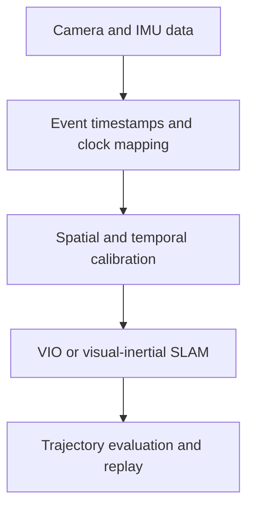

# VIO Open Source Collection

A curated guide to visual-inertial odometry, SLAM, software timing, hardware synchronization, calibration and evaluation.

[English](README.md) · [简体中文](README-zh.md)

[Project catalog](docs/CATALOG.md) · [Integration guide](docs/INTEGRATION.md)

**47 resources · 8 categories · Reference date: 2026-10-23**

## 1. Scope

This collection connects **state estimation** with the **sensor timing and calibration** needed to use it. It is intended for mobile robots, handheld capture, robot-mounted cameras and follower grippers with PC-side processing.

- **Algorithms:** VIO and visual-inertial SLAM, plus visual-only and dense-mapping alternatives identified separately.
- **Acquisition and timing:** clock translation, time-offset estimation, camera triggers, exposure feedback, MCU reference designs and sensor drivers.
- **Integration:** spatial/temporal calibration, IMU noise analysis, replayable recordings and trajectory evaluation.

Entries link to upstream sources and describe capabilities, dependencies and licensing boundaries. This is a documentation collection; follow each upstream project for installation and usage.

## 2. Project index

Each category links to the detailed descriptions and integration notes. Counts include public reference designs and license-restricted resources, which are identified in the catalog.

| Category / count | Examples |
| --- | --- |
| [VIO / inertial SLAM](docs/CATALOG.md#vio) · **10** | OpenVINS, Basalt, ORB-SLAM3, OKVIS2 |
| [Software timing](docs/CATALOG.md#software-sync) · **6** | Cuckoo Time Translator, MAVROS, LinuxPTP |
| [Hardware sync](docs/CATALOG.md#hardware-sync) · **10** | VersaVIS, LIV_handhold, OctoSense |
| [Drivers / SDKs](docs/CATALOG.md#drivers) · **6** | librealsense, DepthAI, Aravis, libcamera |
| [Calibration](docs/CATALOG.md#calibration) · **5** | Kalibr, iKalibr, Allan Variance ROS |
| [Evaluation / recording](docs/CATALOG.md#evaluation) · **3** | evo, rosbag2, MCAP |
| [Mapping extensions](docs/CATALOG.md#mapping) · **6** | OKVIS2-X, FAST-LIVO2, VIGS-SLAM |
| [Restricted source](docs/CATALOG.md#restricted-source) · **1** | cuVSLAM |

## 3. Choose by task

These are entry points for comparison, rather than a performance ranking.

| Task | Starting points and checks |
| --- | --- |
| Establish a VIO baseline | [OpenVINS](https://github.com/rpng/open_vins), [Basalt](https://gitlab.com/VladyslavUsenko/basalt) Check: Camera model, IMU rate, calibration format and target environment |
| Add loop closure and map reuse | [ORB-SLAM3](https://github.com/UZ-SLAMLab/ORB_SLAM3), [OKVIS2](https://github.com/ethz-mrl/okvis2) Check: Initialization, relocalization and coordinate-reset behavior |
| Study software timing | [Cuckoo Time Translator](https://github.com/ethz-asl/cuckoo_time_translator), [MAVROS](https://github.com/mavlink/mavros), [VINS-Mono](https://github.com/HKUST-Aerial-Robotics/VINS-Mono) Check: Clock mapping and measurement-time estimation are separate problems |
| Design hardware timing | [VersaVIS](https://github.com/ethz-asl/versavis), [LIV_handhold](https://github.com/xuankuzcr/LIV_handhold) Check: Trigger support, exposure feedback, voltage levels and frame association |
| Calibrate and compare | [Kalibr](https://github.com/ethz-asl/kalibr), [evo](https://github.com/MichaelGrupp/evo), [rosbag2](https://github.com/ros2/rosbag2) Check: Intrinsics, extrinsics, time offset, reference accuracy and alignment method |
| Extend toward richer maps | [OKVIS2-X](https://github.com/ethz-mrl/OKVIS2-X), [FAST-LIVO2](https://github.com/hku-mars/FAST-LIVO2), [VIGS-SLAM](https://github.com/cvg/VIGS-SLAM) Check: Additional sensors, GPU needs, map latency and component licenses |

For capture SDKs, noise tools, other algorithms and source-available alternatives, see the [complete catalog](docs/CATALOG.md).

## 4. How the pieces fit

Software and hardware timing solve different parts of the same acquisition problem.

The diagram illustrates a sensor-integration reference workflow. Follow the upstream sources in the catalog for implementations of its individual stages.

| Layer | Responsibility and examples |
| --- | --- |
| Hardware events | Trigger exposure or timestamp exposure/IMU events on the device VersaVIS, STM32 and Teensy designs |
| Clock mapping | Relate camera, MCU and PC clocks, including offset and rate differences Cuckoo Time Translator, MAVLink TIMESYNC, LinuxPTP |
| Temporal calibration | Estimate the remaining offset between effective image and IMU measurement times Kalibr, OpenVINS, VINS |
| Association and recording | Match frames/events, select IMU intervals and preserve data for replay Driver buffers, message_filters, rosbag2, MCAP |

Preserve source timestamps and record PC receive times separately. Fixed time offsets may be estimated; random jitter, drift and dropped samples require separate handling. Approximate message pairing alone does not correct sampling times.

Hardware triggering is useful, but VIO prototyping can begin with reliable source timestamps and software timing. Timestamp resolution, synchronization accuracy and pose accuracy are separate quantities.

## 5. Getting started

1. **Describe the input:** camera/shutter model, frame rate, IMU sample rate, timestamp semantics and available compute.
2. **Select a baseline:** use the [task table above](#3-choose-by-task) and read the candidate's catalog entry and upstream setup instructions.
3. **Record before comparing:** keep raw images, IMU samples, source/receive times, sequence numbers and calibration together.
4. **Calibrate and evaluate:** compare algorithms on the same recording, with consistent frames, time alignment, APE/RPE and a quantified reference.
5. **Add complexity as needed:** hardware synchronization, loop closure, LiDAR or dense mapping according to measured limitations.

For a fisheye/IMU follower gripper, the [PC-side integration guide](docs/INTEGRATION.md) covers MCU timing, camera/IMU interfaces, frame IDs, calibration, quality status and grasping-condition evaluation. Visuotactile data can first share the recording timeline; fusion requires an additional contact or state-estimation model.

## 6. Documentation

- [Project catalog](docs/CATALOG.md): all 47 resources, their roles and integration/licensing limits.
- [Follower-gripper integration](docs/INTEGRATION.md): software/hardware timing, interfaces, exposure/timestamps, PC-side responsibilities, product capabilities and evaluation.
- [简体中文文档](README-zh.md): matching Chinese README and guides.

## 7. Maintenance and licensing

When adding or updating an entry, include the official source, sensor inputs, purpose, dependencies, timing assumptions and license. Distinguish VIO from visual-only SLAM, and mark public reference designs with unclear reuse permissions. Update both languages together.

Projects belong to their respective authors. This repository curates links and descriptions; source availability or paper results do not establish performance on your hardware. There is no shared benchmark ranking in this collection.

Check main-code, dependency, model-weight, vendor-SDK and hardware-design licenses separately. **MASt3R-SLAM has a noncommercial restriction; cuVSLAM has NVIDIA-platform restrictions.** Details and license links are in the catalog. This repository has not yet specified a reuse license for its own content; upstream licenses do not automatically license this collection.
