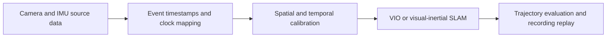

# VIO Open Source Collection

A collection of visual-inertial odometry projects and related software timing, hardware synchronization, drivers, calibration and evaluation tools.

[English](README.md) · [简体中文](README-zh.md)

[Project catalog](docs/CATALOG.md) · [PC-side follower-gripper integration](docs/INTEGRATION.md)

## 1. Scope

**47 resources**, reviewed on **2026-10-23**, for follower grippers, handheld capture and mobile-robot research. This collection provides official source links, purposes and integration boundaries. It does not bundle upstream code or an integrated VIO SDK.

| Category | Count | Focus |
| --- | --- | --- |
| VIO and visual-inertial SLAM | 10 | Odometry, loop closure, fisheye and multiple cameras |
| Software time alignment and clock handling | 6 | Clock mapping, synchronization, online temporal estimation and message association |
| Hardware synchronization platforms and references | 10 | Camera triggers, exposure feedback, MCU firmware and PCBs |
| Sensor drivers and acquisition SDKs | 6 | Source timestamps, frame IDs, PTP and acquisition APIs |
| Spatial and temporal calibration | 5 | Intrinsics/extrinsics, time offsets and IMU noise |
| Trajectory evaluation and recording | 3 | Error analysis, recording and replay |
| Multi-sensor and dense mapping | 6 | LiDAR fusion, learned SLAM and mapping extensions |
| Platform-restricted source-available software | 1 | cuVSLAM, with licensing identified separately |

## 2. Starting points

- First algorithm baseline: OpenVINS. Stereo/wide-angle comparison: Basalt. Full visual-inertial SLAM: OKVIS2.
- Software timing baseline: preserve source timestamps, inspect time offsets with Kalibr, and compare online estimation in OpenVINS or the VINS family.
- MCU/PC clock mapping: CuckooTimeTranslator for one-way translation and MAVLink TIMESYNC for two-way synchronization.
- Hardware integration: VersaVIS for triggering, exposure feedback, common timing and image association; LIV_handhold and LC-Robotics for STM32 references.
- A useful deliverable combines synchronization protocols, calibration files, tracking status, replayable data and error evaluation.

Design software and hardware timing together: devices timestamp measurement events; the PC converts clocks, estimates time offsets, buffers and associates data. Fixed offsets can be estimated; random jitter, clock drift and packet loss need separate handling. Record PC receive time, but do not use it alone as evidence of sensor synchronization.

## 3. Reference workflow

VIO prototyping can begin without hardware triggering. Stability depends on actual timestamps, motion, exposure and image quality. Visuotactile data can first be recorded on the common timeline; fusion requires an additional model.

## 4. Reading and selection

This collection needs no installation. Start with the [full project catalog](docs/CATALOG.md), choose candidates for your camera, IMU and compute platform, then follow their upstream installation instructions. ROS versions, dependencies and hardware requirements differ; there is no common installer.

For a follower gripper with a fisheye camera and IMU, and VIO on a PC, use the [integration guide](docs/INTEGRATION.md) to check exposure semantics, source timestamps, frame IDs, interfaces, calibration and operating conditions.

## 5. Maintenance and licensing

When updating an entry, check its official source, capabilities, dependencies, license and translation together. Source availability or paper results do not establish validation on the target hardware.

Projects belong to their respective authors. This repository curates links and descriptions. Check software, dependencies, model weights and hardware-design licenses separately; noncommercial or platform-restricted resources are identified in the catalog. This repository has not yet specified a reuse license for its own content; upstream licenses do not automatically license this collection.
