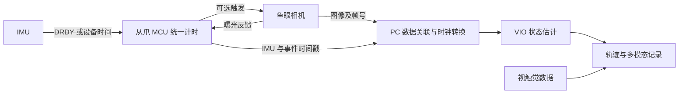

# 从夹爪 PC 端 VIO 集成

[English](INTEGRATION.md) · [简体中文](INTEGRATION-zh.md) · [首页](../README-zh.md)

以下是集成设计参考，具体信号能力以相机、IMU 和模组固件为准。

## 1. 软同步与硬同步

| 层次 | 主要处理的问题 | 对应资源 |
| --- | --- | --- |
| 硬件触发与事件时间标记 | 何时曝光、何时产生 IMU 数据，在设备侧记录 | VersaVIS、STM32 或 Teensy 同步工程 |
| 时钟转换或对时 | MCU、相机和 PC 时钟的偏移与速率差 | CuckooTimeTranslator、MAVROS TIMESYNC、LinuxPTP |
| 视觉惯性时间标定 | 图像与 IMU 的有效测量时刻仍相差多少 | Kalibr、iKalibr、OpenVINS、VINS、Ts Online Optimization |
| 消息关联 | 哪张图对应哪个事件、应使用哪一段 IMU | 帧号协议、驱动缓存、message_filters |
| 数据记录 | 保存原始时间及关联信息，便于复现 | rosbag2、MCAP |

硬件时间戳分辨率不等于同步精度，时间同步精度也不等于 VIO 定位精度。固定时间偏移可以在适当运动条件下估计；随机延迟、时钟漂移、丢样本和曝光模糊需要分别处理。相机与 IMU 不必同频，也不必恰好同时采样。

## 2. 从爪 PC 端的参考架构

从爪侧负责采集及时间标记，PC 负责缓存关联、时钟转换、标定应用和 VIO。图像数据可以经相机自己的 USB 链路到 PC，时间事件与 IMU 经 MCU 链路到 PC，两条链路通过帧号或设备元数据关联。

视触觉可先独立记录并对齐到公共时间轴，不必作为运行 VIO 的前置条件。只有加入接触模型、滑移或物体状态估计算法后，才能称为视觉惯性触觉融合。

### 硬件接口预留

| 信号或能力 | 作用 | 实施条件 |
| --- | --- | --- |
| 相机 Trigger In | MCU 请求相机曝光 | 由传感器及模组固件真正支持；预留 GPIO 本身不够 |
| Exposure Active 或 Strobe Out | MCU 记录实际曝光事件 | 核实信号定义、边沿与曝光关系；优先用定时器输入捕获 |
| IMU DRDY 或传感器样本时间 | 标记新 IMU 数据 | 核实内部滤波及输出延迟，DRDY 不必然等于物理采样瞬间 |
| IMU FSYNC | 在支持的型号上建立同步事件或采样关系 | 有的器件只记录事件，不直接控制采样；按数据手册处理 |
| 帧号与可关联元数据 | PC 把图像匹配到正确曝光事件 | 丢帧后能够检测并恢复，避免仅靠到达顺序配对 |
| 外部同步输入输出与测试点 | 连接双爪、主端或其他传感器并测量 | 按系统需求预留，电平与脉宽由器件确定 |

### 固件与 SDK 的数据要求

- 每条数据保留源时间戳、序号和设备计时会话标识，另记 PC 收包时间用于测量传输延迟。
- 图像保留帧号、曝光时长及时间戳语义；卷帘相机还要记录或明确行读出模型。
- 用明确的映射将设备时间转换到公共时间轴，处理时钟速率差、计数回绕及设备重启。
- 分别统计相机丢帧、触发未响应、IMU 重复样本、乱序、FIFO 溢出和关联失败。
- VIO 输出包含位姿参考系、TCP 外参约定、时间戳、跟踪质量及重初始化或坐标重置事件。

## 3. 方案选择与实施顺序

| 现有条件 | 起步方案 | 后续增强 |
| --- | --- | --- |
| 相机与 IMU 有可靠源时间戳 | 软件时钟映射加离线时间标定，再开 VIO 在线估计 | 评估快速运动及长期漂移后决定硬同步改板 |
| 相机支持曝光反馈 | MCU 同一计时器记录曝光事件和 IMU 时间 | 加入硬触发、帧号关联及自动曝光补偿 |
| 相机支持硬触发和曝光反馈 | 参考 VersaVIS，完成触发与实际曝光闭环记录 | 扩展双爪及多模态统一时间轴 |
| 相机只有 PC 收帧时间 | 先测延迟分布，低速原型验证 | 优先争取设备时间戳或曝光事件，不把平均延迟当可靠同步 |
| 使用支持 PTP 的 GigE 相机 | LinuxPTP 配合相机设备时间戳和驱动 | 仍核实曝光语义及 IMU 如何接入同一时钟 |

1. 原始数据接入：明确鱼眼型号、快门类型、实际帧率、IMU 型号和真实样本率。
2. 软同步基线：统一时间轴、标定时间偏移，在同一段数据上比较启用与关闭在线时间估计。
3. 硬件增强：根据现有传感器能力选择 Trigger、Exposure 或 FSYNC，不先假定必须换相机。
4. 算法对照：优先 OpenVINS，再增加 Basalt 或 OKVIS2；保留同一份原始记录与配置。
5. 产品交付：把接口、标定、质量状态、录包回放和评估结果整理为同一套 SDK 能力。

## 4. 验证项目

| 验证层 | 应记录什么 | 判定重点 |
| --- | --- | --- |
| 电气与事件 | 触发、曝光反馈、IMU 事件的逻辑分析仪波形 | 测量事件关系，不用定时器分辨率代替同步误差 |
| 时间与数据完整性 | 时间偏移分布、时钟漂移、丢包、序号、重启恢复 | 改变 PC 负载、USB 负载和运行时长后仍能正确关联 |
| 标定 | 重投影误差、运动激励、时间偏移重复性、完整外参 | 在独立记录上验证，不能只看单次拟合误差 |
| 位姿 | 对可靠参考的 APE、RPE、跟踪成功率及端到端延迟 | 机械臂 FK 可作对照，但未经误差核实不能直接作为真值 |
| 抓取工况 | 遮挡、弱纹理、短距离往复、停顿、旋转、电机振动 | 分别报告失效和恢复，不能只展示成功轨迹 |

项目有源码或论文结果，表示存在可研究和复用的实现；实际产品能力以当前硬件组合的验证为准。主库采用开放许可证，也不意味着依赖和硬件设计自动采用同一许可。授权不清的公开工程可先学习结构，直接集成代码前再核对具体文件。

## 5. 曝光与测量时间

**曝光时长**是图像传感器为一张图像积累光信号的时间，常用单位为 µs 或 ms。它与图像到达 PC 的时刻、帧率是不同量。相机可能报告配置值或实际有效曝光时长，具体以型号文档为准，参见 [Basler Exposure Time](https://docs.baslerweb.com/exposure-time)。

**VIO 不要求一律手动曝光。** 手动曝光通常指关闭自动曝光后设置曝光时长；自动曝光会按图像亮度调节该时长。固定曝光便于建立可复现基线，之后应在实际自动曝光工况下复验。保留每帧实际曝光元数据，并按估计器要求定义图像测量时刻。相机是否允许自动曝光与特定触发模式组合，需要逐型号确认，参见 [Exposure Auto](https://docs.baslerweb.com/exposure-auto) 和 [Exposure Mode](https://docs.baslerweb.com/exposure-mode)。

| 时间量 | 记录与使用方式 |
| --- | --- |
| 曝光开始与结束 | 优先记录设备元数据或曝光反馈边沿，明确对应哪一行或哪一帧 |
| 图像有效测量时刻 | 对全局快门，若估计器要求曝光中心，可按开始时刻加一半实际曝光时长近似；不要无条件套用到所有模型 |
| 卷帘读出 | 各行测量时间不同，需相应相机模型、行读出参数或明确采用的参考行约定 |
| IMU 时间 | 明确采样时刻、DRDY、FIFO 时间戳及滤波延迟之间的关系 |
| PC 接收时间 | 单独保存，用于分析排队、USB 或网络传输及处理延迟 |

硬触发决定何时请求采集；曝光反馈帮助确认实际事件；时间标定估计有效测量时刻的剩余偏移。三者仍需配合帧号关联和丢事件检测。预留接口时同时记录电平、输入输出方向、有效边沿、最小脉宽及连接器引脚，不能仅写“预留同步 GPIO”。

## 6. 从接口开放到产品能力

从爪采集鱼眼、IMU 与视触觉数据，PC 负责估计，是可采用的系统分工；价值要由完整的数据链路与目标工况验证体现。手持 UMI 示教采集和机器人末端从爪定位具有不同的安装、遮挡与运动条件，应分别评估。

| 已实现并验证的内容 | 可对应的产品能力 |
| --- | --- |
| 原始图像与 IMU 接口、单位和时间语义 | 可接入第三方算法的传感器数据接口 |
| 同步、标定、PC 端 VIO、质量状态与重置通知 | 可评估的视觉惯性定位套件 |
| 视触觉与位姿统一记录、标定版本及回放 | 面向抓取与示教的多模态数据采集能力 |
| 引入接触或滑移模型并验证融合结果 | 相应的视觉惯性触觉融合能力 |

适合形成卖点的是可复用标定、可靠时间轴、可解释的跟踪状态、录包回放和有条件说明的误差数据。算法在 PC 运行并不减弱这些交付项；是否满足控制反馈需求，仍取决于实际频率、连续性和端到端延迟。

建议 SDK 至少交付：源时钟及单位说明、帧号和设备会话标识、曝光元数据、完整位姿及参考系、传感器到 TCP 的变换约定、标定版本、跟踪质量、丢包统计与重初始化事件。将数据开放、算法集成和实机验收分别说明。是否存在同类成品、是否构成首创，需要按具体产品型号、开放接口和实际 SDK 能力调查，本合集不作市场排他性承诺。
