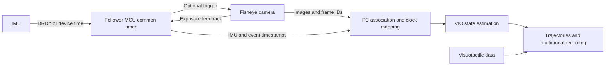

# PC-side VIO for a follower gripper

[English](INTEGRATION.md) · [简体中文](INTEGRATION-zh.md) · [Home](../README.md)

This is an integration design reference. Signal capabilities depend on the camera, IMU and module firmware.

## 1. Software and hardware synchronization

| Layer | Problem addressed | References |
| --- | --- | --- |
| Hardware triggers and event timestamps | Record when exposure or IMU data generation occurs at the device | VersaVIS, STM32/Teensy synchronization projects |
| Clock mapping or synchronization | Offset and rate differences between MCU, camera and PC clocks | CuckooTimeTranslator, MAVROS TIMESYNC, LinuxPTP |
| Visual-inertial temporal calibration | Remaining offset between effective image/IMU measurement times | Kalibr, iKalibr, OpenVINS, VINS, Ts Online Optimization |
| Message association | Match images to events and select the correct IMU interval | Frame-ID protocols, driver buffers, message_filters |
| Recording | Preserve original times and associations for reproduction | rosbag2, MCAP |

Hardware timestamp resolution is not synchronization accuracy, and synchronization accuracy is not VIO pose accuracy. Fixed offsets can be estimated under suitable motion; random latency, clock drift, lost samples and exposure blur need separate handling. Cameras and IMUs need not run at the same rate or sample at exactly the same instant.

## 2. Reference architecture

The follower device acquires and timestamps data. The PC buffers and associates it, converts clocks, applies calibration and runs VIO. Images may reach the PC over the camera's USB connection while events and IMU data use the MCU connection. Frame IDs or device metadata associate the two paths.

Visuotactile data can first be recorded independently on a common timeline. It is not a prerequisite for VIO. Claim visual-inertial-tactile fusion only after adding contact, slip or object-state estimation models.

### Hardware interfaces

| Signal or capability | Purpose | Implementation conditions |
| --- | --- | --- |
| Camera Trigger In | MCU requests exposure | Must be supported by the sensor and module firmware; spare GPIO alone is insufficient |
| Exposure Active or Strobe Out | MCU records the actual exposure event | Verify signal definition and edge/exposure relationship; prefer timer input capture |
| IMU DRDY or sample timestamps | Identify newly available IMU data | Check internal filtering/output delay; DRDY need not equal the physical sampling instant |
| IMU FSYNC | Establish a synchronization event or sampling relationship on supporting models | Some devices only record events rather than trigger sampling; follow the datasheet |
| Frame IDs and association metadata | Match images to the correct exposure events on the PC | Detect and recover after dropped frames; avoid arrival-order-only pairing |
| External synchronization I/O and test points | Connect two grippers, a leader or other sensors and measure timing | Reserve as required; levels and pulse widths depend on the devices |

### Firmware and SDK data

- Preserve source timestamps, sequence numbers and a device-timer session identifier; also record PC receive time to study transport latency.
- Preserve image frame IDs, exposure duration and timestamp semantics. For rolling shutters, record or specify the row-readout model.
- Map device time explicitly onto a common timeline, accounting for rate differences, counter wraparound and device restarts.
- Count dropped camera frames, unfulfilled triggers, duplicate IMU samples, reordering, FIFO overflow and association failures separately.
- Include pose frames, TCP extrinsic conventions, timestamps, tracking quality and reinitialization/coordinate-reset events in VIO output.

## 3. Selection and implementation sequence

| Available capabilities | Initial approach | Further improvement |
| --- | --- | --- |
| Reliable camera and IMU source timestamps | Software clock mapping, offline temporal calibration, then online VIO estimation | Assess fast motion and long-term drift before deciding on hardware changes |
| Camera exposure feedback | One MCU timer records exposure events and IMU timing | Add hardware triggering, frame-ID association and automatic-exposure compensation |
| Hardware trigger and exposure feedback | Follow VersaVIS for trigger/actual-exposure recording | Extend the common timeline to two grippers and other modalities |
| Only PC frame-arrival time | Measure latency distribution and validate a low-speed prototype | Obtain device timestamps or exposure events; average latency is not reliable synchronization |
| PTP-capable GigE camera | LinuxPTP with camera device timestamps and driver support | Still verify exposure semantics and how the IMU joins the clock domain |

1. Identify the actual fisheye model, shutter type, frame rate, IMU model and real sample rate.
2. Establish software timing: common timeline, calibrated offsets, and online-estimation-on/off comparisons on the same recording.
3. Add hardware support according to existing Trigger, Exposure or FSYNC capabilities; do not assume camera replacement is required.
4. Compare algorithms: start with OpenVINS, then Basalt or OKVIS2, preserving the same raw recordings and configurations.
5. Deliver interfaces, calibration, quality status, recording/replay and evaluation together as SDK capabilities.

## 4. Evaluation

| Layer | What to record | What to assess |
| --- | --- | --- |
| Electrical signals/events | Logic-analyzer traces of triggers, exposure feedback and IMU events | Measure actual event relationships; timer resolution is not synchronization error |
| Timing and data integrity | Offset distributions, drift, losses, sequence numbers and restart recovery | Correct associations under different PC/USB loads and run durations |
| Calibration | Reprojection error, excitation, repeated offset estimates and complete extrinsics | Validate on independent recordings rather than a single fit |
| Pose | APE, RPE, tracking success and end-to-end latency against a reliable reference | Robot FK can be a comparison, but is not ground truth without quantified errors |
| Grasping conditions | Occlusion, weak texture, short reciprocating motion, pauses, rotation and motor vibration | Report failures and recovery as well as successful trajectories |

Source code and paper results provide implementations to study and reuse. Product capability must be established on the actual hardware combination. An open main-library license does not automatically cover dependencies or hardware designs. Study public reference designs with unclear permissions, but verify file-level licenses before integration.
